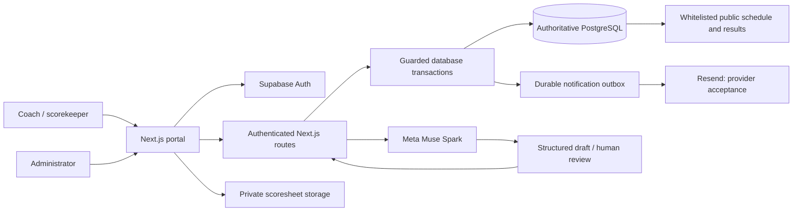

# Architecture

The browser uses a Supabase Auth session. Each mutation sends its bearer access token to a Next.js route. Routes validate the token with `auth.getUser`, validate input, and call PostgreSQL using the same user's authorization. There is no service-role key in the application and no elevated server database client.

## Authoritative workflow

1. Questionnaire facts produce a deterministic initial rating and recommended tier. Meta may interpret context and explain, but cannot replace the stored rubric result.
2. The administrator approves a division. Team registration is pending until that transaction succeeds.
3. Scheduling uses approved teams in the same division, confirmed availability, 60-minute games and 30-minute rest. A bounded greedy round-robin solver reports any unscheduled games. It never fabricates court time. Completed games retain their exact original court and time.
4. The database independently checks the draft. Publication requires a separate authenticated administrator command and matching schedule and data revisions.
5. Private upload paths are scoped to league and uploader. Server code downloads the image under the caller's authorization, checks size/type/magic bytes, computes SHA-256 and optionally sends image input to Meta.
6. A scorekeeper/administrator reviews team names, scores and recorded statistics. Official confirmation is atomic. Corrections require a reason, create an immutable result revision and replay all official results in chronological order for Elo consistency.
7. Three recent verified wins/losses with average differential at least +15/-15 can yield a one-tier proposal. The administrator approves or rejects. After an approved move, future fixtures must be regenerated and published separately.
8. Publication queues email and consented SMS notifications in the same database transaction. A bounded worker claims rows with leases, records provider acceptance, and retries failures with backoff. Real messages are never sent to synthetic example recipients. SMS delivery remains disabled.

## AI orchestration

The Meta Responses agent is limited to four turns, three calls per turn and three allowlisted tools: inspect league, propose balance, draft schedule. Mutation tools run at most once per workflow. Each step and failure is stored in `workflow_runs`; official approvals are unavailable as tools. Input notes and image contents are treated as untrusted data. `store:false` limits provider-side response storage according to the provider API contract; it does not constitute a general zero-retention guarantee.

AI requests have per-user database reservations: 20/hour, 100/day. This is an application request quota, **not a currency spending cap**. API credentials remain server-side. No live calls have been made until credentials and billing/credits are verified.

## Security boundaries

All exposed tables have RLS and no direct browser write grants. API-visible functions are invoker wrappers. Sensitive implementations live in `private`, pin an empty search path, revoke default PUBLIC execution, derive the actor from `auth.uid()` and check actual membership. Their elevated privileges are intentionally confined to the guarded transaction; no policy uses editable user metadata. Public snapshots expose team names, divisions, fixtures and official scores, and return no players, original sheets, contacts, notifications or audit details.

The current client uses Supabase's persisted browser session and bearer API requests, not SSR cookies. React renders user text as text; the application does not inject HTML from AI. Session storage hardening and a production CSP should be revisited before real youth data is accepted.

## Scale and operational limits

The domain solver has a verified 500-team/250-game unit scenario. This is not a production load benchmark. League commands serialize on a league row to prevent concurrent approvals and stale publications. Tenant indexes support season reads and fixture lookups. The snapshot endpoint currently returns the season as one JSON document and ratings replay the season on correction; pagination, per-division scheduling, incremental materialization and a long-running durable worker are future scale work.

Publication automatically starts a bounded notification delivery pass with Next.js `after()` when Resend is configured. Administrators can also resume the queue. Rows, retry times and leases are durable, but **there is no recurring retry scheduler or provider delivery webhook configured yet**. A pass claims up to 20 notifications; larger queues require subsequent passes. `accepted` means the provider returned an ID, not that the email arrived. Five attempts and a 23-hour retry window prevent idempotency-key reuse beyond Resend's 24-hour window.
